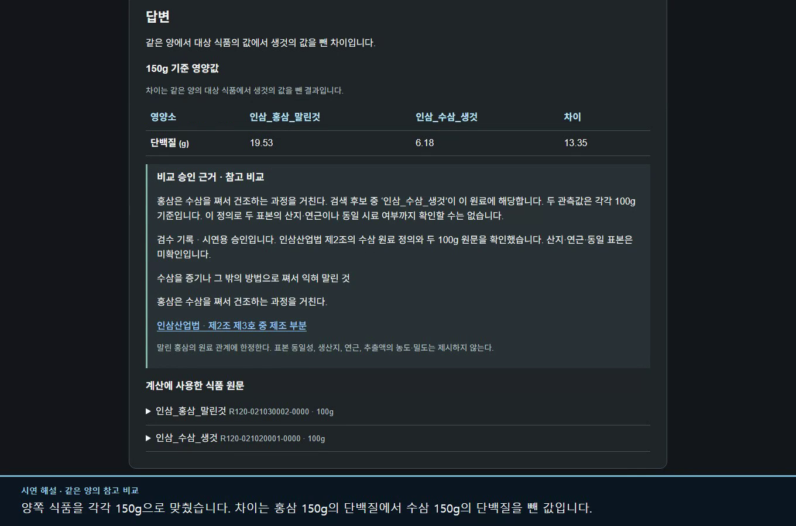

# Refine Dining | 말린 홍삼과 생수삼을 비교해도 될까?

Refine Dining은 공공 식품성분표에서 가공식품에 대응하는 생것을 찾고, 두 식품을 비교할 근거를 보여주는 서비스다. 기존 정제 과정에서는 같은 소분류에 생것이 없으면 비교 목록에서 빠졌다. 이 프로젝트에서는 빠진 식품도 단독으로 조회할 수 있게 하고, 공식 자료로 원료를 확인할 수 있는 경우에만 비교 후보로 제안하는 로컬 RAG를 구현했다.

[3분 시연 영상](../../datasets/week1/2026-11-10/release/nutrition-demo.mp4) · [실행 방법](../../README.md#로컬에서-데모-열기) · [최종 평가 보고서](../../datasets/week1/2026-11-10/release/README.md)

같은 질문을 격리된 시연 DB에서 두 번 실행했다. 승인 전에는 말린 홍삼 150g의 단백질 **19.53g**만 보였다. 검수자가 홍삼의 원료가 수삼이라는 공식 정의와 양쪽의 100g 기준량을 확인하고 승인하자, 수삼 **6.18g**과 차이 **13.35g**이 함께 표시됐다. 두 수치는 서로 다른 표본을 각각 150g으로 환산한 값이다. 실제 수삼 150g을 쪄서 말린 뒤의 단백질 총량을 구하려면 조리 후 중량이나 수율이 더 필요하다. [질문별 API 응답](../../datasets/week1/2026-11-10/release/answer-checks.json)

## 검색이 실패한 자리에서 출발했다

원본 3,701행을 고정하고, 같은 소분류에는 생것이 없지만 같은 출처의 상위 분류에는 생것이 있는 **109건**을 추렸다. 같은 대표식품이 개발과 평가에 걸치지 않도록 식품군 단위로 나눴다. 33개 식품군 77건으로 검색 방식을 조정하고, 14개 식품군 32건은 설정을 고정한 뒤 평가했다. [표본 선정과 분할 기준](../../datasets/week1/2026-11-10/README.md#원본과-분할)

미국산 카무트 가루는 식품명만 벡터로 검색했을 때 1위가 **미국산 어린양 어깨**였고 상위 5개가 전부 육류였다. 검색을 같은 대표식품 안으로 제한하면 밀은 찾을 수 있었지만, 개발 77건 중 28건에서 후보 5개를 채우지 못했다. 그래서 생것 2,388개를 E5로 벡터화하고 **같은 대표식품에서 최대 3개를 먼저 고른 뒤, 전체 검색으로 나머지를 채우는 방식**을 채택했다. 같은 대표식품이 상위 5개에 등장한 질의는 **71건에서 77건**으로 늘었다. 카무트 검색의 앞 세 자리에도 밀이 돌아왔다. 다만 세 후보 모두 원문의 수입 여부가 달라 최종 비교는 보류했다. [네 가지 검색 방식과 식품별 전후 순위](../../datasets/week1/2026-11-10/retrieval-policy/comparison.json)

## 공식 문단과 로컬 LLM은 얼마나 기여했나

식품을 찾는 검색과 제조 근거를 찾는 검색을 분리했다. 전자는 식품명 임베딩을 사용하고, 후자는 식품·가공 상태에 적용되는 공식 문단을 추린 뒤 관련 표현으로 순위를 매긴다. 로컬 Qwen3-8B에는 후보 5개와 관련 문단을 보내고, 응답의 식품코드가 후보 안에 있는지, 인용문이 검색된 원문과 일치하는지 코드로 검사했다. 같은 개발 77건에서 식품 원문, 공식 문단, 모델이 각각 어떤 결정을 바꾸는지 측정했다. [문단 검색과 생성 응답 검증 코드](../../backend/tools/rag_match/grounded_rag.py)

- **식품 원문만 사용**했을 때는 통밀가루와 통밀 생것 한 쌍을 참고 후보로 제안했다. 양쪽 모두 100g 기준이고 가공 전 품목을 읽을 수 있지만 산지는 확인되지 않았다.
- **공식 문단을 추가**하자 말린 백삼과 말린 홍삼이 각각 수삼에 연결돼 참고 후보가 **3건**이 됐다. 세 건 모두 검수 대기다. 홍삼 추출물은 원문이 100mL 기준이라 수삼 100g과의 차이를 계산하지 않았다. [근거 문단과 적용 범위](../../datasets/week1/2026-11-10/evidence/passages.json)
- **같은 자료를 로컬 Qwen에 제공**하자 모델은 **77건 모두 보류**했다. 이 결과를 보고 검수 화면에는 원문과 공식 문단으로 설명할 수 있는 3건을 참고 후보로, 나머지 74건을 보류로 표시했다. 일반 영양 조회는 Spring이 계산한다. 사용자가 승인된 비교의 이유를 물을 때는 로컬 모델이 승인 근거 중 제시할 문장을 고를 수 있다. [개발 판정 원문](../../datasets/week1/2026-11-10/local-rag/development.json)

## 영양값과 승인을 원문까지 추적할 수 있게 했다

이전 수집기는 빈칸과 실제 0을 모두 숫자 0으로 저장했다. 공식 다운로드와 동결 DB를 식품코드·출처·기준량·관측 조건으로 다시 대조해 24개 영양 항목에서 **실제 0인 11,048칸**과 **결측 25,699칸**을 구분했다. 예를 들어 당류가 0으로 관측된 식품에는 0g을 표시하고, 원천 값이 비어 있으면 차이 계산도 비워 둔다. [원천 대조 코드](../../backend/tools/rag_match/prepare_rag_catalog.py) · [실제 0과 결측을 확인한 API 사례](../../datasets/week1/2026-11-10/release/answer-checks.json)

관리자는 React 화면에서 원문 두 건과 인용 문단을 확인한다. Spring과 MySQL은 제안·승인·보류를 자료 버전과 함께 저장한다. 원본이나 제안 근거가 바뀌면 이전 승인을 새 비교에 적용하지 않는다. 같은 승인 요청이 동시에 두 번 들어올 때 결정이 중복되지 않는지, 자료 갱신 뒤 과거의 승인 ID가 거부되는지도 격리된 MySQL에서 검증했다. [승인 저장 로직](../../backend/src/main/java/com/refinedining/domain/nutrition/NutritionReviews.java) · [MySQL 통합 테스트](../../backend/tools/rag_match/test_nutrition_mysql_http.py)

## 어디까지 검증했나

명시적으로 짝을 찾을 수 있는 별도 455쌍은 모두 기준 생것을 상위 5개 안에서 찾았다. 어려운 최종 평가 **32건은 전부 보류**했다. 예를 들어 곤약 분말의 1위 후보는 ‘곤약 국수형 생것’이었고, 이 항목이 분말을 만들기 직전의 원료라는 근거는 없었다. 최종 32건에는 독립 검수 정답이 없어 실제 매칭 정확도와 오연결률은 산출할 수 없다. 개발 보류 74건 중 가장 큰 이유는 품종·세부 품목 미확인 34건과 부위·가식 범위 미확인 22건이었다. [최종 평가 사례](../../datasets/week1/2026-11-10/release/README.md) · [보류 사유 전수 기록](../../datasets/week1/2026-11-10/evidence/hold-audit.json)

새 체크아웃에서 인덱스와 캐시를 비우고 개발 77건을 다시 실행했다. 검색 순위·선택 코드·판정·인용은 일치했고, GPU에서 새로 생성한 설명 5건은 강조한 차이 항목이 달랐다. 개발과 최종 평가에서 외부 추론 API 호출은 0회였다. 실제 HTTP 시나리오 17개로 단건 조회, 승인 전후 비교, 단위 충돌, 결측, 모호한 식품 선택을 확인했다. [재현 환경과 검증 기록](../../datasets/week1/2026-11-10/release/reproduction.json)
